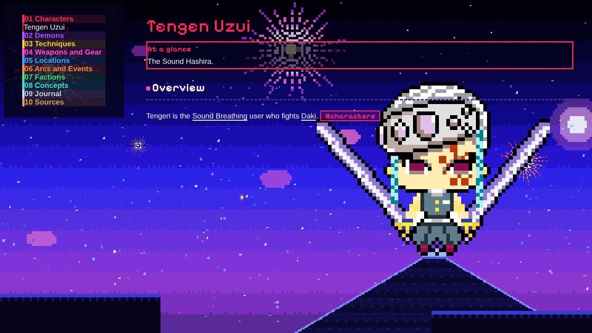

# Tengen Pixel — pixel-art Obsidian theme + Claude-ready vault kit

**Chibi pixel-art Tengen Uzui (traced from your reference sprite) on a Yoshiwara rooftop, both cleavers raised, animated pixel fireworks bursting in a navy-to-electric-blue-and-violet night sky.**
Built with the same technique as the pixel theme in `dnd-game-brain` (pixel SVG scene behind translucent panes, Pixelify Sans headings, hard 3px borders, block shadows).
Every note belongs to a **colour-coded category**, and a built-in toolkit lets **Claude Code in the terminal** keep the vault ultra-densely cross-linked.



> Preview rendered from the real `theme.css` in a mock Obsidian-style window (single frame; the scene animates: radial-streak fireworks, twinkling blue sparkles, drifting pink smoke, rising sparks, idle bob).

## What's in the box

| Path | What it is |
|---|---|
| `theme.css`, `manifest.json` | The installable Obsidian theme (generated — don't hand-edit) |
| `categories.json` | **Single source of truth** for the colour-sorted categories (folder, tag, colour, icon, callout) |
| `src/*.css`, `src/pixel-scene.js` | Theme sources. `pixel-scene.js` draws the pixel scene (sprite Tengen, roof, skyline, fireworks) as animated SVG |
| `plugins/dataview/` | Dataview, copied from your DND vault; the installer enables it |
| `tools/vault.js` | Zero-dependency Node tool: build theme, install, scaffold, hubs, new note, normalize, **autolink**, **check** |
| `snippets/` | Optional toggles: `no-scene`, `bright-scene`, `readable-mode` |
| `templates/vault-CLAUDE.md` | The instructions installed into a vault so its Claude knows the rules |
| `starter-vault/` | A ready-to-open sample vault: 62 Demon Slayer notes, 10 hubs, ~960 internal links, zero broken links |

## Install into your friend's vault (recommended)

Needs Node 16+ (Claude Code users already have it).

```bash
git clone https://github.com/wilburnya80/Obsidian-Cosmetic-Changes-.git
cd Obsidian-Cosmetic-Changes-
git checkout claude/kind-ritchie-gw1wti       # until it is merged
node tools/vault.js install "/path/to/his/vault"
```

That installs the theme and sets it active, installs and enables the Dataview plugin (Obsidian asks once to turn on community plugins), enables per-category link colours, colours the graph view, drops the toolkit in a hidden `.tengen/` folder, writes (or merges into) the vault's `CLAUDE.md`, and creates the category folders plus hub notes. **It does not move, edit or delete any existing note.** Original `appearance.json`/`graph.json`/`CLAUDE.md` are backed up once as `*.tengen-bak`.

Then:

```bash
cd "/path/to/his/vault"
claude
```

and tell Claude something like *"Follow CLAUDE.md. Dry-run `normalize` and `autolink`, show me the summary, then organise my notes into the categories."*

### Manual install (theme only)
Copy `theme.css` + `manifest.json` into `<vault>/.obsidian/themes/Tengen Pixel/`, then Settings → Appearance → Themes → pick it. (Optional: copy `snippets/*.css` into `<vault>/.obsidian/snippets/`.)

### Just try it
Open `starter-vault/` as a vault in Obsidian (*Open folder as vault*), trust the vault, and the theme is already active. Open the **Graph view** to see the colour-sorted clusters.

## The colour system

Colour is how the vault is sorted — the same colour shows up in the file explorer, graph nodes, tags, callouts, note titles and (in Reading view) every link to a note of that category.

| | Category | Folder | Colour |
|---|---|---|---|
| 🏯 | Hubs | `00 Hub` | `#ffe9a8` |
| 🗡️ | Characters | `01 Characters` | `#ff2d55` |
| 👹 | Demons | `02 Demons` | `#a855f7` |
| 🌀 | Techniques | `03 Techniques` | `#ffc93c` |
| ⚔️ | Weapons and Gear | `04 Weapons and Gear` | `#ff4fd8` |
| 🏮 | Locations | `05 Locations` | `#3ea6ff` |
| 🎆 | Arcs and Events | `06 Arcs and Events` | `#ff8a3d` |
| 🏛️ | Factions | `07 Factions` | `#4ade80` |
| 💡 | Concepts | `08 Concepts` | `#2ee6d6` |
| 📓 | Journal | `09 Journal` | `#c9d4e8` |
| 📚 | Sources | `10 Sources` | `#d9a066` |

Rename, recolour or add categories by editing `categories.json` and running `node tools/vault.js build` (in an installed vault: `node .tengen/tools/vault.js build`).

## Extreme internal linking

* Every note has `category`, `tags`, `cssclasses: [cat-…]`, `aliases`, `summary`, `up`, `related`.
* Every note ends with a **Connections** block linking its category hub, `Home` and `A-Z Index`.
* `autolink` turns *every* mention of any other note's title or alias into a `[[wikilink]]` (aliases keep your wording: `[[Tengen Uzui|Tengen]]`). Skips code, headings, existing links, URLs and the Connections/auto regions.
* Hubs, `Home` and `A-Z Index` are auto-generated lists, so a new note is reachable the moment you run `hubs`.
* `check` reports broken links, missing hub links, notes with fewer than 6 outgoing links, orphans, frontmatter gaps and unlinked mentions, and exits non-zero on broken links.

```bash
node .tengen/tools/vault.js new characters "Some Name" --summary "One line" --related "Other Note"
node .tengen/tools/vault.js normalize [--write]     # frontmatter + hub links on existing notes
node .tengen/tools/vault.js autolink  [--write] [--mode first]
node .tengen/tools/vault.js hubs
node .tengen/tools/vault.js colors
node .tengen/tools/vault.js check [--strict]
```

Anything that edits existing notes is a **dry run unless you pass `--write`**.

## Tweaking the look

* Scene: `src/pixel-scene.js` (sky palette, firework list, smoke, sparkles, roof) and `src/tengen-sprite.json` (the chibi Tengen, traced from your reference image — swap the rows to change him). Panes/typography: `src/20-chrome.css`, `src/30-typography.css`, palette in `src/10-variables.css` (`--tg-pane`, `--tg-side` control how much scene shows through).
* Snippets (Settings → Appearance → CSS snippets): `no-scene` hides the animation, `bright-scene` makes panes see-through, `readable-mode` makes them nearly opaque.
* After editing run `node tools/vault.js build`, then `node tools/vault.js install starter-vault` to sync the sample vault.

## Honest limitations

* Headings use the Pixelify Sans web font (loaded from Google Fonts, as in your DND theme); offline it falls back to a system font.
* In **Live Preview / editing** mode every link uses one colour; **per-category link colours** apply in Reading view, hover previews and the Properties panel. Folder, tag, graph, title and callout colours work everywhere.
* Not tested inside Obsidian itself (none in the cloud container): screenshot-tested in Chromium against a mock of Obsidian's DOM, reusing the container/pane rules from your working DND snippet.
* Sample lore in `starter-vault/` is illustrative; replace with your own notes.
